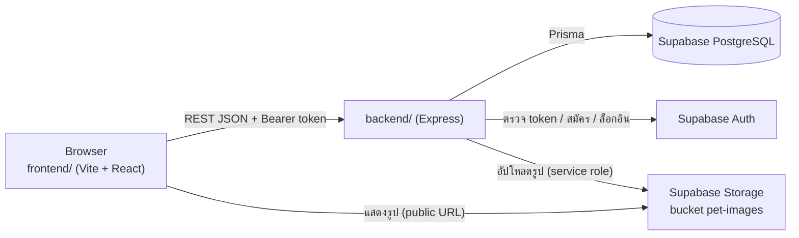

# 🐾 PawHome

> เว็บหาบ้านให้น้องหมาแมว: โพสต์หาบ้าน ค้นหาน้อง และยื่นคำขอรับเลี้ยงได้ในที่เดียว

## Project Overview

PawHome เป็นเว็บแอป Full-Stack สำหรับเจ้าของหรือบ้านพักสัตว์ที่ต้องการหาบ้านให้น้องหมาแมว ผู้ใช้สมัครสมาชิก โพสต์น้อง กรองค้นหา กดรายการโปรด และยื่นคำขอรับเลี้ยงได้ ส่วนเจ้าของโพสต์ใช้พิจารณาคำขอ

ระบบแยกเป็นสองส่วน:
- **Frontend:** React (Vite) คุยกับ Backend ผ่าน REST อย่างเดียว ไม่ถือ key ของ Supabase
- **Backend:** Express ถือ service role key และตรวจสิทธิ์ทุก request

## ✨ Features

### Implemented (ใช้งานได้ในเว็บสาธารณะ)

- สมัครสมาชิก / เข้าสู่ระบบด้วย Supabase Auth (ยืนยันอีเมล · ต่ออายุ session อัตโนมัติด้วย refresh token · ใช้ได้หลายแท็บ)
- หน้าแรก (น้องที่ต้องการบ้านด่วน) · ฟีดน้องทั้งหมด พร้อมตัวกรองชนิด จังหวัด ความเร่งด่วน ช่วงเวลา และคำค้น
- โพสต์ / แก้ไข / ลบน้อง พร้อมอัปโหลดรูป (ตรวจชนิดไฟล์จากไบต์จริง ขนาดไม่เกิน 2 MB)
- รายการโปรด (♡)
- ยื่นคำขอรับเลี้ยง · ยกเลิกคำขอ · เจ้าของอนุมัติหรือปฏิเสธคำขอ (ใช้ ConfirmDialog แทน `window.confirm`)
- หน้า "ของฉัน" (โพสต์ของฉัน / คำขอที่ยื่น / รายการโปรด) · หน้าความรู้เบื้องต้น · หน้ารายละเอียดข่าวสาร 3 หน้า
- ทุกหน้าใช้ข้อมูลจริงจาก Backend เท่านั้น (ไม่มีโหมดข้อมูลจำลองในเบราว์เซอร์ · ไม่มี fallback เงียบ ๆ)

### Implemented · Tested Locally · ต้องตรวจบน Supabase Development (ยังไม่ deploy)

- **หน้าผู้ดูแล** (`/admin`):
  - ใช้ข้อมูลจริงจาก `/api/admin/*` เท่านั้น
  - ยืนยันสิทธิ์กับ Backend ก่อนแสดงข้อมูลใด ๆ · ไม่มี fallback เป็นข้อมูลจำลอง
- **Admin Backend API:**
  - RBAC (`ADMIN` / `SUPER_ADMIN`) และตรวจโพสต์
  - คิวติดตามคำขอ ตรวจผลส่งมอบ ระงับบัญชี
  - ประกาศ รายงาน และ Audit Log แบบ append-only
- **Migration 001** พร้อม rollback และ verification SQL (ทดสอบบน PGlite)
- **ขั้นตอนรับเลี้ยงแบบส่งมอบจริง (Backend + หน้าเว็บสาธารณะ):**
  - ตอบรับ → นัดส่งมอบ → รายงานสองฝ่าย → ยืนยัน · แจ้งข้อพิพาท · ไทม์ไลน์ · ผู้ดูแลตรวจผล
  - ปิดไว้เป็นค่าเริ่มต้น (`ADOPTION_HANDOVER_WORKFLOW=false`) จนกว่าจะ deploy และทดสอบบน Supabase Development
- **แจ้งเตือนในเว็บ:** แท็บ "การแจ้งเตือน" ใน /me + ตัวนับบนเมนูบัญชี · สร้างตามทุกเหตุการณ์ของคำขอและประกาศ (ไม่ส่งอีเมล/SMS)
- **ประกาศหน้าแรกจาก API:** ใช้ประกาศที่เผยแพร่จากหน้าผู้ดูแล (ตั้งเวลา/หมดอายุได้) · ไม่มีประกาศ → การ์ดเดิม
- **ชุดข้อมูลทดสอบสมจริง `pawhome-demo-v1`:** 40 ผู้ใช้ · 100 น้อง · 180 คำขอ · seed รันซ้ำได้ + verification SQL ([คู่มือ](docs/mock-data-guide.md))
- **งานตามเวลา (cron):** บันทึกเหตุการณ์แจ้งเตือน 24 / 48 / 72 ชม. · ยังไม่ส่งอีเมลหรือ SMS
- **สคริปต์แต่งตั้ง SUPER_ADMIN คนแรก:** `npm run admin:bootstrap`

### Planned

- ส่งอีเมลผ่าน Custom SMTP (ตอนนี้แจ้งเตือนในเว็บเท่านั้น)
- รูปหลายรูป / รูปปก / ลำดับรูปของโพสต์ (schema มีรูปเดียว)
- ตั้งค่าการแจ้งเตือนรายผู้ใช้

## 📸 Screenshots

ยังไม่มีภาพหน้าจอในรีโป · เมื่อเพิ่ม ให้เก็บไฟล์ในรีโป (เช่น `.github/screenshots/`) แล้วอ้างอิงด้วย relative path

## 🧰 Tech Stack

| ส่วน | เทคโนโลยี |
| --- | --- |
| Frontend | React 19, Vite 6, TypeScript 5.8, React Router 7, TanStack Query 5, Zustand 5, Tailwind CSS 4 |
| Backend | Node.js 22, Express 5, Prisma 6, Zod 3, @supabase/supabase-js 2, multer 2 |
| Database / Auth / Storage | Supabase PostgreSQL (Row Level Security) · Supabase Auth · Supabase Storage |
| Testing | Vitest, Supertest, PGlite (PostgreSQL ในหน่วยความจำ ไม่ต้องใช้ Docker), Playwright scripts (E2E ของ Admin Mock / Real Mode) |
| Hosting | Vercel (2 Projects: frontend / backend) |

## 🏗️ System Architecture



- หน้าเว็บไม่ถือ key ของ Supabase · Backend ถือ `SUPABASE_SERVICE_ROLE_KEY` และ `DATABASE_URL`
- Backend ต่อฐานข้อมูลผ่าน Prisma และตรวจสิทธิ์เองในโค้ด
- RLS ในฐานข้อมูลเป็นด่านที่สอง กันการยิงตรงผ่าน PostgREST ด้วย anon key

## 📁 Project Structure

```
PawHome/
├─ frontend/        Vite + React + TS
│  ├─ src/pages/    หน้าเว็บสาธารณะ
│  ├─ src/admin/    หน้าผู้ดูแล (Mock Preview / Real Mode)
│  └─ scripts/      E2E ของหน้าผู้ดูแล (Playwright)
├─ backend/         Express + Prisma + Zod
│  ├─ src/          routes → controllers → services → repositories
│  ├─ prisma/       schema.prisma (แผนที่ตาราง ใช้ query เท่านั้น)
│  ├─ scripts/      seed-users · smoke-live · grant-super-admin
│  └─ tests/        unit / API / database / admin / workflow / bootstrap + e2e harness
├─ database/        schema.sql · mock-data.sql · migrations/ · verification/
└─ docs/            เอกสาร Admin + Deploy (เก็บเฉพาะไฟล์ที่ระบบต้องใช้ ที่เหลืออยู่ในเครื่อง)
```

เอกสาร Admin: [สถาปัตยกรรม](docs/admin-architecture.md) · [รายงานการพัฒนา](docs/admin-fullstack-implementation.md) · [แผน Migration](docs/admin-migration-plan.md) · [Deployment Checklist](docs/admin-deployment-checklist.md) · [แต่งตั้ง Super Admin](docs/admin-super-admin-bootstrap.md)

รายละเอียดแต่ละส่วน: [frontend/README.md](frontend/README.md) · [backend/README.md](backend/README.md)

## 🚀 Getting Started

ต้องมี **Node.js 22+** และโปรเจกต์ Supabase ที่รัน `database/schema.sql` แล้ว

```bash
# Backend
cd backend
npm install                 # รัน prisma generate ให้เอง
cp .env.example .env        # Windows: copy .env.example .env แล้วใส่ค่าจาก Supabase
npm run seed:users          # สร้างบัญชีทดลอง 3 บัญชีใน Supabase Auth (dev/demo)
npm run dev                 # http://localhost:3000/api/health

# Frontend (อีกหน้าต่าง)
cd frontend
npm install
cp .env.example .env
npm run dev                 # http://localhost:5173
```

หน้าเว็บต้องมี Backend เสมอ (ไม่ได้ตั้ง `VITE_API_URL` = แสดงหน้าแจ้งว่าตั้งค่าไม่ครบ)

บัญชีทดลอง (dev/demo เท่านั้น): `pong@pawhome.test` · `shelter@pawhome.test` · `mind@pawhome.test` (สร้างโดย `seed:users`)

## 🔐 Environment Variables

ค่าจริงอยู่ใน `.env` ซึ่งอยู่ใน `.gitignore` · ให้ commit เฉพาะ `.env.example`

**`frontend/.env`**

| ตัวแปร | หมายเหตุ |
| --- | --- |
| `VITE_API_URL` | ลิงก์ Backend รวม `/api` |

**`backend/.env`**

| ตัวแปร | หมายเหตุ |
| --- | --- |
| `PORT` | ค่าเริ่มต้น `3000` |
| `CORS_ORIGIN` | โดเมนหน้าเว็บ คั่นด้วย `,` |
| `APP_URL` | หน้าที่ลิงก์ยืนยันอีเมลพากลับมา (ค่าเริ่มต้น = โดเมนแรกของ `CORS_ORIGIN`) |
| `DATABASE_URL` | 🔒 connection string · dev ใช้ Session pooler · Vercel ใช้ Transaction pooler + `?pgbouncer=true&connection_limit=1` |
| `SUPABASE_URL` | Project URL อย่างเดียว (`https://<ref>.supabase.co`) |
| `SUPABASE_ANON_KEY` | ใช้สมัคร / ล็อกอิน |
| `SUPABASE_SERVICE_ROLE_KEY` | 🔒 ข้าม RLS ได้ · ใช้ฝั่ง Backend เท่านั้น |
| `STORAGE_BUCKET` | ค่าเริ่มต้น `pet-images` |
| `TRUST_PROXY` | `false` บนเครื่อง dev · `1` บน Vercel |
| `RATE_LIMIT_LOGIN_PER_MINUTE` / `RATE_LIMIT_REGISTER_PER_MINUTE` / `RATE_LIMIT_REFRESH_PER_MINUTE` | ต่อ IP ต่อนาที ค่าเริ่มต้น `10` / `10` / `30` |
| `ADOPTION_HANDOVER_WORKFLOW` | `false` (ค่าเริ่มต้น) = อนุมัติแบบเดิม · `true` = ขั้นตอนส่งมอบเต็ม |
| `FOLLOW_UP_REMINDER_HOURS` / `FOLLOW_UP_ADMIN_HOURS` / `FOLLOW_UP_ESCALATION_HOURS` | นโยบายติดตาม ค่าเริ่มต้น `24` / `48` / `72` |
| `CRON_SECRET` | 🔒 อย่างน้อย 32 ตัวอักษร · ไม่ตั้ง = ปิด endpoint cron |

> 💡 ทุกตัวแปรมีตัวอย่างใน `backend/.env.example` และ `frontend/.env.example` · ค่าเริ่มต้นปลอดภัย: ขั้นตอนส่งมอบปิด · cron ปิด · Admin Real Mode ปิด

## 🗄️ Database Setup

1. Supabase → SQL Editor → รัน `database/schema.sql`
   - ไฟล์นี้รันซ้ำได้ (idempotent)
   - สร้างตาราง `profiles`, `pets`, `favorites`, `adoption_requests`, trigger, RLS และ bucket `pet-images`
2. (dev/demo) `npm run seed:users` แล้วรัน `database/mock-data.sql` และ `database/verification/verify.sql` (ทุกแถวต้อง `ok = true`)
3. **Migration ของระบบ Admin** (`database/migrations/001_admin_workflow.sql`):
   - เพิ่ม stage ของคำขอ, ผลตรวจโพสต์, `admin_memberships`, `admin_audit_logs`, `announcements` และตารางอื่น
   - มีไฟล์ rollback และ `verify-admin.sql`
   - **ยังไม่ได้รันบน Production** · ต้องทดสอบบน Supabase Development และสำรองข้อมูลก่อน
   - ลำดับ Expand/Contract: `001` → `002` → deploy Backend ใหม่ → `003` — ขั้นตอนเต็ม: [docs/admin-migration-plan.md](docs/admin-migration-plan.md)
4. แต่งตั้งผู้ดูแลคนแรก: [docs/admin-super-admin-bootstrap.md](docs/admin-super-admin-bootstrap.md)
5. (Development/Test เท่านั้น) ชุดข้อมูลทดสอบสมจริง: `npm run seed:demo-users` → `database/seeds/001…010` → verification — [docs/mock-data-guide.md](docs/mock-data-guide.md)

ห้ามใช้ `prisma migrate` หรือ `prisma db push` เพราะคำสั่งเหล่านี้ไม่สร้าง RLS, trigger และ FK ไป `auth.users` · โครงสร้างจริงอยู่ที่ไฟล์ SQL

## 🔌 API Overview

ทุก endpoint อยู่ใต้ `/api` · error ตอบรูปแบบเดียว `{ "message": "..." }` · 🔒 = ต้องส่ง `Authorization: Bearer <token>`

| กลุ่ม | Endpoints |
| --- | --- |
| Health | `GET /health` |
| Auth | `POST /auth/register` · `POST /auth/login` · `POST /auth/refresh` · 🔒 `GET /auth/me` · 🔒 `POST /auth/logout` |
| Pets | `GET /pets` · `GET /pets/:id` · 🔒 `POST /pets` · 🔒 `PUT /pets/:id` · 🔒 `DELETE /pets/:id` |
| ของฉัน 🔒 | `GET /me/pets` · `GET/POST /me/favorites` · `DELETE /me/favorites/:petId` · `GET /me/adoptions` · `PATCH /me/profile` |
| คำขอรับเลี้ยง 🔒 | `POST /pets/:id/adoptions` · `GET /pets/:id/adoptions` (เจ้าของ) · `PATCH /adoptions/:id` (อนุมัติ/ปฏิเสธ) · `DELETE /adoptions/:id` (ยกเลิก) |
| อัปโหลด 🔒 | `POST /uploads` (multipart ช่อง `image`) |

**Implemented · ยังไม่ deploy** (ต้องรัน migration 001 ก่อน):

| กลุ่ม | Endpoints |
| --- | --- |
| ส่งมอบ 🔒 | `POST /adoptions/:id/arrange` · `POST /adoptions/:id/handover-reports` · `POST /adoptions/:id/confirm` · `POST /adoptions/:id/dispute` · ใช้ได้เมื่อ `ADOPTION_HANDOVER_WORKFLOW=true` · `GET /adoptions/:id` · `GET /adoptions/:id/timeline` (เฉพาะเจ้าของ/ผู้ขอ) |
| สาธารณะ | `GET /config` · `GET /announcements` |
| แจ้งเตือน 🔒 | `GET /me/notifications` · `PATCH /me/notifications/:id/read` · `POST /me/notifications/read-all` |
| ผู้ดูแล 🔒 | `GET /admin/me` · `GET /admin/dashboard` · `/admin/pets` (+ `/:id`, `/:id/moderation`) · `/admin/adoptions` (+ `/:id`, `/timeline`, `/follow-ups`, `/escalate`, `/review-handover`, `/close`) · `/admin/users` (+ `/:id`, `/:id/suspension`) · `/admin/admins/:userId` (SUPER_ADMIN) · `/admin/announcements` · `GET /admin/reports` · `GET /admin/audit-logs` |
| Cron | `GET /internal/cron/follow-ups` (ต้องมี `Authorization: Bearer <CRON_SECRET>`) |

รายชื่อ route ที่เป็นปัจจุบันที่สุด: [backend/src/routes/index.ts](backend/src/routes/index.ts) · [backend/src/routes/admin.ts](backend/src/routes/admin.ts)

## 🔄 Adoption Workflow

**ที่ใช้งานอยู่ (ค่าเริ่มต้น):**
1. ผู้ขอยื่นคำขอ → น้องเป็น `PENDING`
2. เจ้าของ **อนุมัติ** → น้องเป็น `ADOPTED` ทันที และคำขออื่นของน้องตัวนั้นถูกปฏิเสธอัตโนมัติ
3. หรือเจ้าของ **ปฏิเสธ** → ถ้าไม่มีคำขออื่นรออยู่ น้องกลับเป็น `AVAILABLE`

ผู้ขอยกเลิกได้เฉพาะคำขอที่ยังรอพิจารณา · การยกเลิกกับการอนุมัติที่เกิดพร้อมกันถูกกันด้วย conditional update

**ขั้นตอนใหม่ (In Development — ปิดไว้):**

```
PENDING → ACCEPTED → ARRANGING_HANDOVER → HANDOVER_REPORTED → COMPLETED
             ↘ REJECTED / CANCELLED
```

- `ACCEPTED` ≠ ได้บ้านแล้ว · น้องเป็น `ADOPTED` เมื่อรายงานสองฝ่ายตรงกันและยืนยันครบ หรือผู้ดูแลตรวจยืนยัน
- รายงานขัดกัน → ข้อพิพาท เข้าคิวผู้ดูแล · ผู้ดูแลต้องใส่เหตุผลทุกครั้งที่ปิดเคส
- `FOLLOW_UP_REQUIRED` เป็น flag แยกจาก stage · ไม่มีการอนุมัติ / ปฏิเสธ / ปิดเคสอัตโนมัติตามเวลา
- ข้อมูลที่อนุมัติจากระบบเดิม **ไม่ถูกแปลงเป็น COMPLETED** แต่ map เป็น `ACCEPTED` + รอผู้ดูแลตรวจ

## 🛠️ Admin Dashboard

| ส่วน | สถานะ |
| --- | --- |
| Admin UI (`frontend/src/admin/`) | 8 หน้า: ภาพรวม · จัดการสัตว์เลี้ยง · คำขอรับเลี้ยง (+ รายละเอียดเคส) · ผู้ใช้งาน · ประชาสัมพันธ์ · รายงาน · ตั้งค่า |
| ข้อมูลจริง | **Implemented · Tested Locally** (unit + browser E2E กับ Backend จริงบน PGlite) · ต้องตรวจบน Supabase Development · ยังไม่ deploy |
| Admin API (`backend/src/routes/admin.ts`) | **Implemented · Tested Locally** · ยังไม่ deploy |
| Production | **Not Ready** · ดู [Deployment Checklist](docs/admin-deployment-checklist.md) |

```bash
cd frontend
# VITE_API_URL ชี้ Backend ที่รัน migration แล้ว · เข้าสู่ระบบด้วยบัญชีผู้ดูแล
npm run dev                 # http://localhost:5173/admin
```

Backend ตรวจสิทธิ์ผู้ดูแลทุก request · ไม่ใช่ผู้ดูแล / Backend ยังไม่มี `/api/admin` = หน้าแจ้งว่าไม่มีสิทธิ์หรือเชื่อมต่อไม่ได้ (ไม่แสดงข้อมูล)

## 🧪 Testing

```bash
cd backend && npm test          # unit + API + database + admin + workflow + bootstrap (PGlite ไม่ต้องมี credentials)
cd backend && npm run typecheck
cd frontend && npm test         # session/refresh + กฎขั้นตอน + Real Mode data layer
cd frontend && npm run build    # typecheck + production build
```

ผลที่ตรวจล่าสุด (27 พ.ย. 2026 บนเครื่อง dev):

| ชุด | ผล |
| --- | --- |
| backend `npm test` | 256 / 256 ผ่าน (รวม compatibility matrix ของ migration + preflight) |
| frontend `npm test` | 86 / 86 ผ่าน |
| E2E เว็บสาธารณะ + ผู้ดูแล บนชุดข้อมูลทดสอบ (`public-workflow.e2e.mjs`) | 15 / 15 ผ่าน |
| frontend `npm run build` | ผ่าน · ไม่มีข้อมูลจำลองใน bundle |
| E2E Real Mode (`admin-real.e2e.mjs`: Backend จริง + PGlite, Auth จำลอง) | 14 / 14 ผ่าน |
| Preflight Production (`preflight-production.sql`, อ่านอย่างเดียว) | blocker 9 / 9 ผ่าน |
| `npm run smoke:live` (Supabase จริง) | ไม่ได้รัน |

รายงานเต็ม: [docs/integration-test-report.md](docs/integration-test-report.md) · E2E ใช้ Playwright ที่ไม่ได้ติดตั้งในโปรเจกต์ (ชี้ path ด้วย `PAWHOME_PLAYWRIGHT`) · วิธีรัน: [docs/admin-fullstack-implementation.md](docs/admin-fullstack-implementation.md#วิธีรันซ้ำ)

## ☁️ Deployment

Vercel 2 Projects จาก repo เดียว:

| Project | Root Directory | หมายเหตุ |
| --- | --- | --- |
| Frontend | `frontend` | Framework = Vite · [`frontend/vercel.json`](frontend/vercel.json) rewrite ทุก path ไป `index.html` · ตั้ง `VITE_API_URL=https://<backend-domain>/api` |
| Backend | `backend` | Express zero-config (`export default app` ใน `src/app.ts`) · `TRUST_PROXY=1` · `DATABASE_URL` แบบ Transaction pooler |

Supabase: ตั้ง Site URL และ Redirect URLs เป็นโดเมนจริงของหน้าเว็บ · ตั้ง Custom SMTP ก่อนเปิดให้สมัครจริง (ผู้ส่งอีเมลในตัวส่งได้จำกัด)

## 🛡️ Security

- รหัสผ่านอยู่ใน Supabase Auth · Backend ไม่เก็บรหัสผ่าน
- Service role key และ connection string อยู่ฝั่ง Backend เท่านั้น
- ทุก route ที่แก้ข้อมูลตรวจเจ้าของจาก token · ไม่เชื่อ `ownerId` / `userId` ที่มากับ body
- เบอร์โทรผู้ขอเห็นได้เฉพาะเจ้าของโพสต์ · ไม่อยู่ใน API สาธารณะ
- ตรวจรูปจากไบต์หัวไฟล์และสุ่มชื่อไฟล์ · CORS เปิดเฉพาะ `CORS_ORIGIN` · rate limit ที่ login / register / refresh
- Admin API (ยังไม่ deploy):
  - role อ่านจากตาราง `admin_memberships` ทุก request · ไม่เชื่อ role จาก client และไม่ใช้อีเมลตายตัว
  - ผู้ใช้แต่งตั้งตัวเองไม่ได้ · audit log แก้หรือลบไม่ได้ (trigger ในฐานข้อมูล)

## 📌 Project Status

- **เว็บสาธารณะ:** deploy บน Vercel และใช้งานได้
- **Admin:** ไม่พร้อมใช้งานบน Production
  - Implemented: Admin API · Real Mode · migrations 001–003 · bootstrap script · ขั้นตอนส่งมอบบนเว็บสาธารณะ · แจ้งเตือนในเว็บ · ประกาศหน้าแรก · ชุดข้อมูลทดสอบ
  - Tested Locally: unit / API / RBAC / E2E บน PGlite
  - Requires Supabase Development Verification: migration, RLS กับ JWT จริง, concurrency ขนานจริง
  - Production Ready: **ยังไม่**
  - Blocked: ไม่มี Supabase Development credentials · ยังไม่ deploy · ยังไม่มีบัญชีผู้ดูแลจริง

## ⚠️ Limitations

- Rate limit ของ Backend นับในหน่วยความจำของแต่ละ instance · บน Vercel ให้ใช้ Vercel Firewall และ rate limit ของ Supabase Auth เป็นด่านหลัก
- ไม่มี pagination ในรายการน้องสาธารณะ (เหมาะกับหลักร้อยถึงพันโพสต์)
- ลบโพสต์หรือเปลี่ยนรูปแล้ว ไฟล์เก่าใน Storage ยังอยู่
- ยังไม่มี ESLint (มี TypeScript strict)
- การทดสอบความพร้อมกัน (concurrency) ทำบน PGlite ซึ่งมี session เดียว · การแข่งกันแบบขนานจริงต้องตรวจซ้ำบน Supabase
- Vercel Hobby รัน cron ได้วันละครั้ง · เกณฑ์ 24 / 48 / 72 ชม. จึงไม่ตรงชั่วโมงถ้าใช้ cron อย่างเดียว (คิวผู้ดูแลคำนวณสดทุกครั้งที่เปิด)
- `docs/` เก็บใน Git เฉพาะเอกสาร Admin และ Deploy (เอกสารเก่าอื่น ๆ อยู่ในเครื่องเท่านั้น)

## 📄 License

ยังไม่ได้กำหนด License (ไม่มีไฟล์ `LICENSE` ในรีโป)
