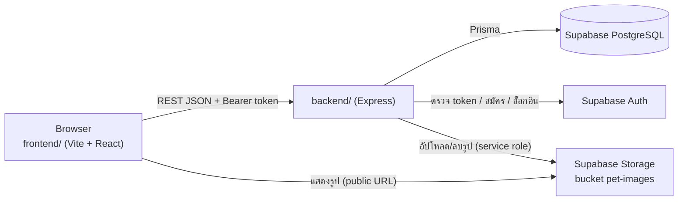

# 🐾 PawHome

> เว็บหาบ้านให้น้องหมาแมว: โพสต์หาบ้าน ค้นหาน้อง ยื่นคำขอรับเลี้ยง และติดตามจนส่งมอบสำเร็จในที่เดียว

## Project Overview

PawHome เป็นเว็บแอป Full-Stack (โปรเจกต์ Final) สำหรับเจ้าของหรือบ้านพักสัตว์ที่ต้องการหาบ้านให้น้องหมาแมว
ผู้ใช้สมัครสมาชิก โพสต์น้อง ค้นหา กดรายการโปรด ยื่นคำขอรับเลี้ยง และนัดส่งมอบกับเจ้าของได้ · ผู้ดูแลติดตามคำขอและตรวจข้อพิพาทผ่านหน้า `/admin`

- **Frontend:** React (Vite) คุยกับ Backend ผ่าน REST อย่างเดียว ไม่ถือ key ของ Supabase
- **Backend:** Express ถือ service role key และตรวจสิทธิ์ทุก request
- ทุกหน้าใช้ข้อมูลจริงจากฐานข้อมูล · ไม่มีโหมดข้อมูลจำลอง

## ✨ Features

### เว็บสาธารณะ

- สมัครสมาชิก / เข้าสู่ระบบด้วย Supabase Auth (ยืนยันอีเมล · ต่ออายุ session อัตโนมัติ · ใช้ได้หลายแท็บ) · แก้ชื่อในโปรไฟล์
- หน้าแรก (น้องที่ต้องการบ้านด่วน) · ฟีดน้องทั้งหมด พร้อมตัวกรองชนิด จังหวัด ความเร่งด่วน ช่วงเวลา และคำค้น
- โพสต์ / แก้ไข / ลบน้อง พร้อมอัปโหลดรูป (ตรวจชนิดไฟล์จากไบต์จริง ≤ 2 MB · เปลี่ยน/ลบโพสต์แล้วลบรูปเก่าใน Storage ให้)
- รายการโปรด (♡)
- คำขอรับเลี้ยง: ยื่น · ยกเลิก · เจ้าของตอบรับหรือปฏิเสธ · นัดส่งมอบ · รายงานการส่งมอบสองฝ่าย · ยืนยัน · แจ้งข้อพิพาท · ไทม์ไลน์ ([ขั้นตอน](#-adoption-workflow))
- แจ้งเตือนในเว็บ: แท็บ "การแจ้งเตือน" ในหน้า "ของฉัน" + ตัวนับบนเมนูบัญชี · สร้างตามเหตุการณ์ของคำขอและประกาศ (ไม่ส่งอีเมล/SMS)
- ประกาศหน้าแรกจากหน้าผู้ดูแล (ตั้งเวลาเผยแพร่/หมดอายุได้) · ยังไม่มีประกาศ → การ์ดตัวอย่าง 3 ใบที่มีป้าย "ตัวอย่าง"
- หน้าความรู้เบื้องต้น

### หน้าผู้ดูแล `/admin` (5 หน้า)

| หน้า | ทำอะไรได้ |
| --- | --- |
| ภาพรวม | ตัวเลขคำขอตามขั้นตอน · คิวที่เกินเวลา · กราฟรายสัปดาห์ · โพสต์และคำขอล่าสุด |
| จัดการสัตว์เลี้ยง | ตรวจโพสต์ · ส่งกลับให้แก้พร้อมเหตุผล · ซ่อน/แสดงโพสต์ (ไม่ลบข้อมูล) |
| คำขอรับเลี้ยง | คิวเรียงตามความเร่งด่วน (เจ้าของเงียบ 24 / 48 / 72 ชม.) · ตั้งธง · บันทึกติดตาม · ตรวจข้อพิพาทพร้อมเหตุผล · ตรวจคำขอที่อนุมัติจากระบบเดิม · ปิดเคส |
| ผู้ใช้งาน | ภาพรวมสมาชิก โพสต์ และประวัติคำขอ (อ่านอย่างเดียว · ไม่แสดงอีเมล/เบอร์โทร) |
| ประชาสัมพันธ์ | สร้าง / แก้ไข / เผยแพร่ / จัดลำดับ / ลบประกาศฉบับร่าง |

สิทธิ์ผู้ดูแลอ่านจากตาราง `admin_memberships` ทุก request · ผู้ดูแลคนแรกแต่งตั้งด้วยสคริปต์ `npm run admin:bootstrap` ([ขั้นตอน](docs/admin-super-admin-bootstrap.md)) · ไม่มี API ให้แต่งตั้งตัวเอง

### Planned

- ส่งอีเมลผ่าน Custom SMTP (ตอนนี้แจ้งเตือนในเว็บเท่านั้น)
- รูปหลายรูปต่อโพสต์ (schema มีรูปเดียว)

## 🧰 Tech Stack

| ส่วน | เทคโนโลยี |
| --- | --- |
| Frontend | React 19, Vite 6, TypeScript 5.8, React Router 7, TanStack Query 5, Zustand 5, Tailwind CSS 4 |
| Backend | Node.js 22, Express 5, Prisma 6, Zod 3, @supabase/supabase-js 2, multer 2 |
| Database / Auth / Storage | Supabase PostgreSQL (Row Level Security) · Supabase Auth · Supabase Storage |
| Testing | Vitest, Supertest, PGlite (PostgreSQL ในหน่วยความจำ เฉพาะเทสต์), Playwright scripts (E2E) |
| Hosting | Vercel (2 Projects: frontend / backend) |

## 🏗️ System Architecture



- หน้าเว็บไม่ถือ key ของ Supabase · Backend ถือ `SUPABASE_SERVICE_ROLE_KEY` และ `DATABASE_URL`
- Backend ต่อฐานข้อมูลผ่าน Prisma และตรวจสิทธิ์เองในโค้ด · RLS เป็นด่านที่สอง กันการยิงตรงผ่าน PostgREST ด้วย anon key

## 📁 Project Structure

```
PawHome/
├─ frontend/        Vite + React + TS
│  ├─ src/pages/    หน้าเว็บสาธารณะ
│  ├─ src/admin/    หน้าผู้ดูแล 5 หน้า (ข้อมูลจาก /api/admin/*)
│  └─ scripts/      E2E (Playwright)
├─ backend/         Express + Prisma + Zod
│  ├─ src/          routes → controllers → services → repositories
│  ├─ prisma/       schema.prisma (แผนที่ตาราง ใช้ query เท่านั้น)
│  ├─ scripts/      seed · bootstrap ผู้ดูแล · backup / restore-test / apply SQL สำหรับ Production
│  └─ tests/        unit / API / database / admin / workflow + e2e harness
├─ database/        schema.sql · migrations/ (000–004) · verification/ · seeds/ (dev/test)
└─ docs/            เอกสาร Admin + Deploy
```

รายละเอียดแต่ละส่วน: [frontend/README.md](frontend/README.md) · [backend/README.md](backend/README.md) · [Deployment Checklist](docs/admin-deployment-checklist.md)

## 🚀 Getting Started

ต้องมี **Node.js 22+** และโปรเจกต์ Supabase ที่รัน `database/schema.sql` + migrations แล้ว ([Database Setup](#️-database-setup))

```bash
# Backend
cd backend
npm install                 # รัน prisma generate ให้เอง
cp .env.example .env        # Windows: copy .env.example .env แล้วใส่ค่าจาก Supabase
npm run dev                 # http://localhost:3000/api/health

# Frontend (อีกหน้าต่าง)
cd frontend
npm install
cp .env.example .env        # VITE_API_URL=http://localhost:3000/api
npm run dev                 # http://localhost:5173
```

⚠️ ใช้ฐานข้อมูล Development แยกจาก Production เสมอ · `npm run dev` ต่อฐานข้อมูลตาม `DATABASE_URL` ใน `backend/.env`

สาธิตบนเครื่องโดยไม่ต้องมี Supabase (Express จริง + PostgreSQL ในหน่วยความจำ + ชุดข้อมูลเล็ก · **ไม่ใช่ระบบจริง**): `cd backend && npm run dev:demo` — [database/seeds/minimal/README.md](database/seeds/minimal/README.md)

## 🔐 Environment Variables

ค่าจริงอยู่ใน `.env` (อยู่ใน `.gitignore`) · commit เฉพาะ `.env.example` · ห้ามใส่ค่าจริงใน README หรือโค้ด

**`frontend/.env`**

| ตัวแปร | หมายเหตุ |
| --- | --- |
| `VITE_API_URL` | ลิงก์ Backend รวม `/api` · ไม่ตั้ง = หน้าเว็บแสดงหน้าแจ้งว่าตั้งค่าไม่ครบ |

**`backend/.env`**

| ตัวแปร | หมายเหตุ |
| --- | --- |
| `PORT` | ค่าเริ่มต้น `3000` |
| `CORS_ORIGIN` | โดเมนหน้าเว็บ คั่นด้วย `,` |
| `APP_URL` | หน้าที่ลิงก์ยืนยันอีเมลพากลับมา (ค่าเริ่มต้น = โดเมนแรกของ `CORS_ORIGIN`) |
| `DATABASE_URL` | 🔒 connection string · Vercel ใช้ Transaction pooler + `?pgbouncer=true&connection_limit=1` |
| `SUPABASE_URL` | Project URL (`https://<ref>.supabase.co`) |
| `SUPABASE_ANON_KEY` | ใช้สมัคร / ล็อกอิน |
| `SUPABASE_SERVICE_ROLE_KEY` | 🔒 ข้าม RLS ได้ · ใช้ฝั่ง Backend เท่านั้น |
| `STORAGE_BUCKET` | ค่าเริ่มต้น `pet-images` |
| `TRUST_PROXY` | `false` บนเครื่อง dev · `1` บน Vercel |
| `RATE_LIMIT_LOGIN_PER_MINUTE` / `_REGISTER_` / `_REFRESH_` | ต่อ IP ต่อนาที ค่าเริ่มต้น `10` / `10` / `30` |
| `ADOPTION_HANDOVER_WORKFLOW` | `true` = เปิดนัดส่งมอบ/รายงาน/ยืนยันในหน้าเว็บ · `false` (ค่าเริ่มต้น) = เจ้าของอนุมัติแบบเดิมแล้วรอผู้ดูแลตรวจ |
| `FOLLOW_UP_REMINDER_HOURS` / `_ADMIN_` / `_ESCALATION_` | เกณฑ์ความเร่งด่วนในคิวผู้ดูแล ค่าเริ่มต้น `24` / `48` / `72` (ต้องเรียงน้อยไปมาก) |

## 🗄️ Database Setup

1. Supabase → SQL Editor → รัน `database/schema.sql` (รันซ้ำได้ · สร้างตารางหลัก, trigger, RLS, bucket `pet-images`)
2. รัน migrations ตามลำดับ: `000_lock_prisma_migrations` → `001_admin_workflow` → `002_notifications_announcements` → `003_admin_workflow_contract`
   - ทุกไฟล์อยู่ใน `begin … commit` และมีไฟล์ `.rollback.sql`
   - ฐานข้อมูลที่มีข้อมูลจริงแล้ว: ทำตาม [Deployment Checklist](docs/admin-deployment-checklist.md) (preflight → backup → restore test → apply + verify)
   - `004_simplify_admin` (ลบตาราง `admin_audit_logs`, `user_suspensions` ที่โค้ดไม่ใช้แล้ว) **ไม่บังคับ** · Production ยังไม่ได้รัน
3. แต่งตั้งผู้ดูแลคนแรก: [docs/admin-super-admin-bootstrap.md](docs/admin-super-admin-bootstrap.md)
4. (Development/Test เท่านั้น) ชุดข้อมูลทดสอบ: [docs/mock-data-guide.md](docs/mock-data-guide.md) · มี guard ปฏิเสธฐานข้อมูลที่มีผู้ใช้จริง

ห้ามใช้ `prisma migrate` หรือ `prisma db push` · โครงสร้างจริงอยู่ที่ไฟล์ SQL (สร้าง RLS, trigger และ FK ไป `auth.users`)

## 🔌 API Overview

ทุก endpoint อยู่ใต้ `/api` · error ตอบรูปแบบเดียว `{ "message": "..." }` · 🔒 = ต้องส่ง `Authorization: Bearer <token>`

| กลุ่ม | Endpoints |
| --- | --- |
| ระบบ | `GET /health` (ต่อฐานข้อมูลได้) · `GET /ready` (migration ครบ) · `GET /config` |
| Auth | `POST /auth/register` · `POST /auth/login` · `POST /auth/refresh` · 🔒 `GET /auth/me` · 🔒 `POST /auth/logout` |
| Pets | `GET /pets` · `GET /pets/:id` · 🔒 `POST /pets` · 🔒 `PUT /pets/:id` · 🔒 `DELETE /pets/:id` |
| ของฉัน 🔒 | `GET /me/pets` · `GET/POST /me/favorites` · `DELETE /me/favorites/:petId` · `GET /me/adoptions` · `PATCH /me/profile` |
| คำขอรับเลี้ยง 🔒 | `POST /pets/:id/adoptions` · `GET /pets/:id/adoptions` (เจ้าของ) · `PATCH /adoptions/:id` (ตอบรับ/ปฏิเสธ) · `DELETE /adoptions/:id` (ยกเลิก) · `GET /adoptions/:id` · `GET /adoptions/:id/timeline` |
| ส่งมอบ 🔒 | `POST /adoptions/:id/arrange` · `POST /adoptions/:id/handover-reports` · `POST /adoptions/:id/confirm` · `POST /adoptions/:id/dispute` (เมื่อ `ADOPTION_HANDOVER_WORKFLOW=true`) |
| แจ้งเตือน 🔒 | `GET /me/notifications` · `PATCH /me/notifications/:id/read` · `POST /me/notifications/read-all` |
| ประกาศ | `GET /announcements` |
| อัปโหลด 🔒 | `POST /uploads` (multipart ช่อง `image`) |
| ผู้ดูแล 🔒 | `GET /admin/me` · `GET /admin/dashboard` · `/admin/pets` (+ `/:id`, `/:id/moderation`) · `/admin/adoptions` (+ `/:id`, `/:id/timeline`, `/:id/follow-ups`, `/:id/review-handover`, `/:id/close`) · `GET /admin/users` (+ `/:id`) · `/admin/announcements` (+ `/:id`) |

รายชื่อ route ล่าสุด: [backend/src/routes/index.ts](backend/src/routes/index.ts) · [backend/src/routes/admin.ts](backend/src/routes/admin.ts)

## 🔄 Adoption Workflow

```
PENDING → ACCEPTED → ARRANGING_HANDOVER → HANDOVER_REPORTED → COMPLETED
   ↘ REJECTED      ↘ CANCELLED (ผู้ขอยกเลิกก่อนรายงานส่งมอบ)
```

1. ผู้ขอยื่นคำขอ → น้องเป็น `PENDING` · เจ้าของได้แจ้งเตือน
2. เจ้าของ **ตอบรับ** → `ACCEPTED` (ยังไม่ใช่ได้บ้านแล้ว) หรือ **ปฏิเสธ** → `REJECTED`
3. เจ้าของเริ่มนัดส่งมอบ → ทั้งสองฝ่ายรายงานวันที่และผลการส่งมอบ
4. รายงานตรงกันและยืนยันครบทั้งสองฝ่าย → `COMPLETED` · น้องเป็น `ADOPTED` · คำขออื่นของน้องตัวนั้นถูกปฏิเสธอัตโนมัติ
5. รายงานไม่ตรงกันหรือมีฝ่ายแจ้งข้อพิพาท → เข้าคิวผู้ดูแล · ผู้ดูแลตรวจและบันทึกเหตุผลก่อนปิดเป็นสำเร็จ

- ไม่มีการอนุมัติ / ปฏิเสธ / ปิดเคสอัตโนมัติตามเวลา · ความเร่งด่วนในคิวผู้ดูแลคำนวณสดจากเวลาที่เจ้าของเงียบ
- ปิด `ADOPTION_HANDOVER_WORKFLOW` → เจ้าของ "อนุมัติ" แล้วน้องเป็น `ADOPTED` ทันทีแบบเดิม และคำขอเข้าคิวให้ผู้ดูแลตรวจการส่งมอบ
- คำขอที่อนุมัติจากระบบเดิมก่อน migration **ไม่ถูกแปลงเป็น COMPLETED** แต่รอผู้ดูแลตรวจ (legacy review)

## 🧪 Testing

```bash
cd backend && npm test          # unit + API + database + admin + workflow (PGlite ไม่ต้องมี credentials)
cd backend && npm run typecheck
cd frontend && npm test
cd frontend && npm run build    # typecheck + production build
```

| ชุด (27 พ.ย. 2026) | ผล |
| --- | --- |
| backend `npm test` | 249 / 249 ผ่าน |
| frontend `npm test` | 85 / 85 ผ่าน |
| E2E เว็บสาธารณะ + ผู้ดูแล (`public-workflow.e2e.mjs`) | 15 / 15 ผ่าน |
| E2E หน้าผู้ดูแล (`admin-real.e2e.mjs`) | 14 / 14 ผ่าน |

E2E รันกับ Express จริง + PGlite + Auth จำลอง (ไม่แตะ Supabase) · Playwright ไม่ได้ติดตั้งในโปรเจกต์ (ชี้ path ด้วย `PAWHOME_PLAYWRIGHT`) · วิธีรันอยู่ที่หัวไฟล์ใน `frontend/scripts/`

## ☁️ Deployment

Vercel 2 Projects จาก repo เดียว · deploy อัตโนมัติเมื่อ push `main`

| Project | Root Directory | หมายเหตุ |
| --- | --- | --- |
| `paw-home` (Frontend) | `frontend` | Vite · [`frontend/vercel.json`](frontend/vercel.json) rewrite ทุก path ไป `index.html` · `VITE_API_URL=https://<backend-domain>/api` |
| `paw-home-backend` (Backend) | `backend` | Express zero-config (`export default app` ใน `src/app.ts`) · `TRUST_PROXY=1` · `DATABASE_URL` แบบ Transaction pooler |

ตรวจหลัง deploy: `GET /api/health` = 200 · `GET /api/ready` = 200 · Supabase Auth: ตั้ง Site URL / Redirect URLs เป็นโดเมนหน้าเว็บ

## 🛡️ Security

- รหัสผ่านอยู่ใน Supabase Auth · Backend ไม่เก็บรหัสผ่าน · service role key และ connection string อยู่ฝั่ง Backend เท่านั้น
- ทุก route ที่แก้ข้อมูลตรวจเจ้าของจาก token · ไม่เชื่อ `ownerId` / `userId` ที่มากับ body
- เบอร์โทรผู้ขอเห็นได้เฉพาะเจ้าของโพสต์ · ไม่อยู่ใน API สาธารณะ
- ตรวจรูปจากไบต์หัวไฟล์และสุ่มชื่อไฟล์ · CORS เปิดเฉพาะ `CORS_ORIGIN` · rate limit ที่ login / register / refresh
- Admin: role อ่านจาก `admin_memberships` ทุก request · ไม่เชื่อ role จาก client · ไม่ใช้อีเมลตายตัว
- RLS เปิดทุกตารางใน `public` · ตาราง `_prisma_migrations` ปิดจาก anon/authenticated (migration 000)

## ⚠️ Limitations

- Rate limit ของ Backend นับในหน่วยความจำของแต่ละ instance · บน Vercel ให้ใช้ Vercel Firewall และ rate limit ของ Supabase Auth เป็นด่านหลัก
- ไม่มี pagination ในรายการน้องสาธารณะ (เหมาะกับหลักร้อยถึงพันโพสต์)
- แจ้งเตือนในเว็บเท่านั้น (ยังไม่มีอีเมล)
- ยังไม่มี ESLint (มี TypeScript strict)

## 📄 License

ยังไม่ได้กำหนด License (ไม่มีไฟล์ `LICENSE` ในรีโป)
