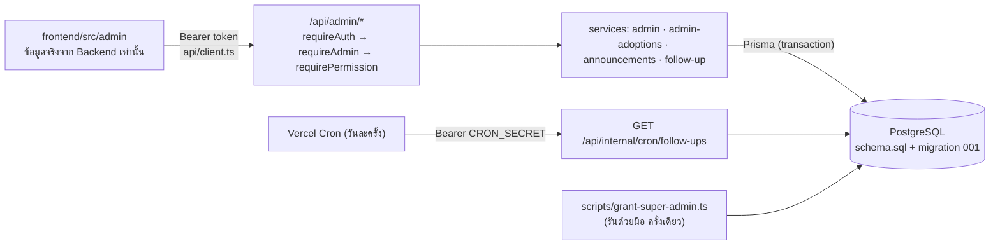

# PawHome Admin — Architecture (Current vs Required)

อัปเดต 27 พ.ย. 2026 · เทียบระบบก่อนงาน Admin กับสิ่งที่พัฒนาแล้วในรอบนี้

## ภาพรวม

## Current (ก่อนงานนี้) → Implemented (หลังงานนี้)

| เรื่อง | ก่อน | หลัง |
| --- | --- | --- |
| ผู้ดูแล | ไม่มี · Admin UI เป็น Mock อย่างเดียว | ตาราง `admin_memberships` (ADMIN / SUPER_ADMIN) · ตรวจทุก request ฝั่ง Backend |
| ตั้ง role | — | `PUT /api/admin/admins/:userId` (SUPER_ADMIN) · คนแรกด้วย bootstrap script |
| คำขอรับเลี้ยง | `status` PENDING/APPROVED/REJECTED · อนุมัติ = น้อง ADOPTED ทันที | เพิ่ม `stage` 7 ขั้น (status ยังคงอยู่และตรงกันด้วย constraint) · ส่งมอบ/ยืนยัน/ข้อพิพาท |
| ข้อมูลอนุมัติเดิม | — | map เป็น `ACCEPTED + legacy_review` (ไม่ใช่ COMPLETED) · เข้าคิวผู้ดูแล |
| โหมดอนุมัติ | — | `ADOPTION_HANDOVER_WORKFLOW=false` (ค่าเริ่มต้น) = พฤติกรรมสาธารณะเดิม · `true` = ขั้นตอนส่งมอบเต็ม |
| ติดตามเคส | — | ความเร่งด่วนคำนวณสดจาก `last_activity_at` (24/48/72 ชม. ตั้งค่าได้) · flag แยกจาก stage |
| แจ้งเตือน | — | `notification_events` (idempotent) จาก cron · ยังไม่ส่งอีเมล/SMS |
| ตรวจโพสต์ | ไม่มี | `pets.visibility` VISIBLE/HIDDEN/CHANGES_REQUESTED/REVIEW · สาธารณะเห็นเฉพาะ VISIBLE |
| ระงับบัญชี | ไม่มี | `user_suspensions` · requireAuth ปฏิเสธ (403) |
| ประกาศ | `data/promos.ts` (คงที่) | ตาราง `announcements` + CRUD ผู้ดูแล + `GET /api/announcements` (หน้าแรกยังใช้ promos.ts) |
| Audit | ไม่มี | `admin_audit_logs` append-only (trigger กัน update/delete/truncate) |
| RLS | ตารางเดิม 4 ตาราง | ตารางใหม่ทั้งหมดเปิด RLS · สิทธิ์รายคอลัมน์กันเขียน stage/visibility ตรงผ่าน PostgREST |

## การตัดสินใจหลัก

- **ใช้ตาราง membership แทน `profiles.role`:** `profiles` มี policy "update own" อยู่แล้ว ถ้าเก็บ role ในตารางนี้ ผู้ใช้จะแก้ role ตัวเองผ่าน PostgREST ได้
- **คง `status` เดิมไว้คู่กับ `stage`:** API สาธารณะและหน้าเว็บเดิมใช้ `status` · เพิ่ม `stage` เป็นฟิลด์ใหม่ (additive)
- **ค่าเริ่มต้นยังใช้โหมดอนุมัติเดิม:** หน้าเว็บสาธารณะยังไม่มีปุ่มรายงาน/ยืนยันส่งมอบ ถ้าเปิดขั้นตอนใหม่ทันที น้องจะไม่มีวันเป็น ADOPTED
- **Real Mode ใช้หน้าจอเดิม:** `admin/real.ts` โหลดข้อมูลจริงแล้วแปลงเป็นรูปแบบเดียวกับ Mock store หน้าจอจึงไม่ต้องเขียนใหม่
- **ไม่มี mock fallback:** Real Mode เริ่มด้วย store ว่าง · โค้ด seed ถูกตัดออกตอน build (ตรวจด้วย grep ใน `dist`)

## ช่องว่างที่ยังเหลือ

ดู [admin-fullstack-implementation.md](admin-fullstack-implementation.md#11-remaining-blockers)
